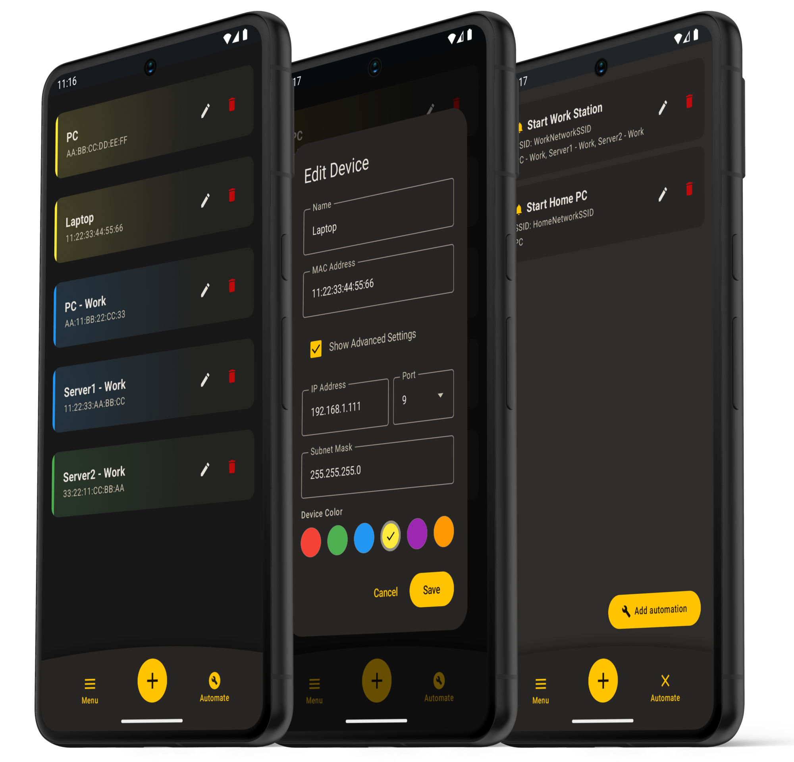

<div align="center">

<p></p>

# OpenWOL
### A simple, private and efficient Wake-on-LAN app for Android.

[](https://www.gnu.org/licenses/agpl-3.0.txt)


<br>
   <div align="center">
   <a href="https://f-droid.org/packages/com.juliencardoux.openwol">
      
   </a>
   <a href="https://gitlab.com/api/v4/projects/julien.cardoux%2Fopenwol/packages/generic/openwol/latest/OpenWOL.apk">
      
   </a>
   </div>
</div>

## 🚀 Features

- Send Wake-on-LAN Packets to wake up devices on your local network
- Create automations to trigger a wake up command on a specific SSID *(WiFi)* connection
- Notify *(if enabled)* when an automation is triggered
- Privacy first: no tracking, no ads, zero data collection and fully open-source
- No network scanning & no background pings
- Simple and straight to the point app

## 📸 Screenshots



## 📲 Download

The latest signed APK is downloadable from [F-Droid](https://f-droid.org/packages/com.juliencardoux.openwol) or directly from [GitLab](https://gitlab.com/api/v4/projects/julien.cardoux%2Fopenwol/packages/generic/openwol/latest/OpenWOL.apk).

> ⚠️ Android will display a warning during installation because the APK is sideloaded and not distributed through the Google Play Store, therefore not verified by Google. This is expected behavior for any APK installed outside of the Play Store. You will need to enable **"Install from unknown sources"** in your Android settings to proceed.

## 🔐 Permissions

| Permission                    | Required for                                                       |    Mandatory    |
|-------------------------------|--------------------------------------------------------------------|:---------------:|
| `INTERNET`                    | Sending UDP magic packets over the network                         |     ✅ Core      |
| `ACCESS_NETWORK_STATE`        | Detecting whether the device is on a local network (Wi-Fi or VPN)  |     ✅ Core      |
| `VIBRATE`                     | Haptic feedback when a packet is sent                              |     ✅ Core      |
| `ACCESS_WIFI_STATE`           | Reading the current Wi-Fi SSID to match automations                | ⚙️ Automations¹ |
| `ACCESS_COARSE_LOCATION`      | Required by Android alongside fine location to read the Wi-Fi SSID | ⚙️ Automations¹ |
| `ACCESS_FINE_LOCATION`        | Required by Android to read the Wi-Fi SSID for automations         | ⚙️ Automations¹ |
| `ACCESS_BACKGROUND_LOCATION`  | Allows automations to trigger when the app is in the background    | ⚙️ Automations¹ |
| `POST_NOTIFICATIONS`          | Sending a push notification when an automation fires               | ⚙️ Automations¹ |
| `FOREGROUND_SERVICE`          | Running the automation service in the foreground                   | ⚙️ Automations¹ |
| `FOREGROUND_SERVICE_LOCATION` | Required to declare a foreground service that uses location access | ⚙️ Automations¹ |

> Location permissions are used **exclusively** to read the Wi-Fi network name (SSID). No location data is ever collected, stored, or shared.
>
> ¹ Automations are optional features and can be declined by the user. The app will function perfectly as a manual Wake-on-LAN utility without these permissions.

## 🔧 Local Setup

To build and run this project locally:

1. Clone the repository:
   ```bash
   git clone https://gitlab.com/julien.cardoux/openwol.git
   ```

2. Open the project in [Android Studio](https://developer.android.com/studio).

3. Let Gradle sync and resolve all dependencies automatically.

4. Connect an Android device or start an emulator, then run the app.

## 🤔 How to Use

### BIOS Setup
Enable **Wake on LAN** or **Power On By PCI-E** in your computer's BIOS settings.

### Windows Setup
In **Device Manager**, go to your **Network Adapter** properties. Under the **Advanced** tab, enable:
- *Allow this device to wake the computer*
- *Wake on Magic Packet*
- *Wake on magic packet when system is in the S0ix power state*

### Networking
If waking fails, use **Advanced Settings** in OpenWOL to specify your PC's IP address and Subnet Mask.

### App Setup
1. Open the app and tap **Add device**.
2. Enter your device's name, MAC address, IP address (or broadcast address), and port (default: `9`).
3. Tap the device card to send a Magic Packet and wake it up.
4. *(Optional)* Set up an automation under **Automations** to automatically send a wake packet when your phone connects to a specific Wi-Fi SSID.


> ⚠️ It is best to set a specific IP address to avoid sending the Magic Packet to your entire network range.

## 🤗 Contributing

Contributions are welcome. If you'd like to help and have the time, feel free to reach out or submit improvements.

1. Start by doing a [fork](https://gitlab.com/julien.cardoux/openwol/-/forks/new) of this repository.

2. Clone the fork and add the upstream:
   ```bash
   git clone https://gitlab.com/<your-username>/<fork-name>.git
   cd <fork-name>
   git remote add upstream https://gitlab.com/julien.cardoux/openwol.git
   git fetch upstream
   ```

3. Create a new branch and start making your changes:
   ```bash
   git checkout -b <your-branch-name>
   # Make your changes & test them
   git push origin <your-branch-name>
   ```

4. Sync with the OpenWOL repository:
   ```bash
   git fetch upstream
   git merge upstream/main
   # Carefully resolve any merge conflicts
   # Test the modifications after merging
   git push origin <your-branch-name>
   ```

5. Submit a merge request by going to your *fork repository*, navigate to your *branch* and **Create merge request**.  
   Set a clear, descriptive title and provide an explicit explanation of the changes in the description field.

<br>

🎉 Thanks for contributing to *(any)* open source projects.

## 💡 Future Improvements

Here are ideas and features to add in the future:

- [x] **F-Droid** deployment
- [ ] **Backup & restore:** Allow exporting and importing saved devices and automations.
- [ ] **Widget:** Add a home screen widget to send a Packet directly without opening the app.
- [ ] **Automate:** Add new automations ideas.
- [ ] **Groups:** Add the possibility to group devices.

## 🐛 Known Issues

- Automations can be unintentionally triggered after a power outage or internet drop, as the phone reconnecting to the Wi-Fi SSID fires the automation regardless of intent

## 🗨️ Contact

Feel free to open an issue or submit a merge request.  
You can also reach out via [GitLab Issues](https://gitlab.com/julien.cardoux/openwol/-/issues) or by email at `openwol@juliencardoux.fr`.

## ⚖️ License

OpenWOL is licensed under the [**AGPLv3** (GNU Affero General Public License version 3)](https://www.gnu.org/licenses/agpl-3.0.html).

All third party components used in this project are licensed under their own terms.

## 📦 Credits

This project uses the following open source resources:

- [Kotlin](https://kotlinlang.org/) - Apache 2.0 (JetBrains)
- [Jetpack Compose](https://developer.android.com/compose) - Apache 2.0 (Google) - UI framework
- [Material Design 3](https://m3.material.io/) - Apache 2.0 (Google) - UI components and theming
- [AndroidX](https://developer.android.com/jetpack/androidx) - Apache 2.0 (Google) - Core, Lifecycle, SplashScreen
- [kotlinx.serialization](https://github.com/Kotlin/kotlinx.serialization) - Apache 2.0 (JetBrains) - Data serialization
- [Google Fonts Icons](https://fonts.google.com/icons) - Apache 2.0 (Google) - Icons
- [Shields.io](https://shields.io/) - Badges
- [iMockupPRO](https://imockup.pro/generator?device=google-pixel-8-pro) - Mockup
- [F-Droid Artwork](https://gitlab.com/fdroid/artwork) - GPL 3.0 / CC-BY-SA 3.0 (F-Droid) - "Get it on F-Droid" store badge